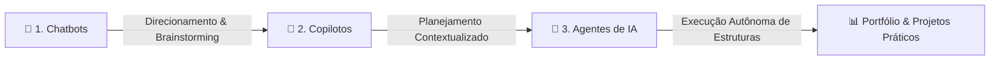
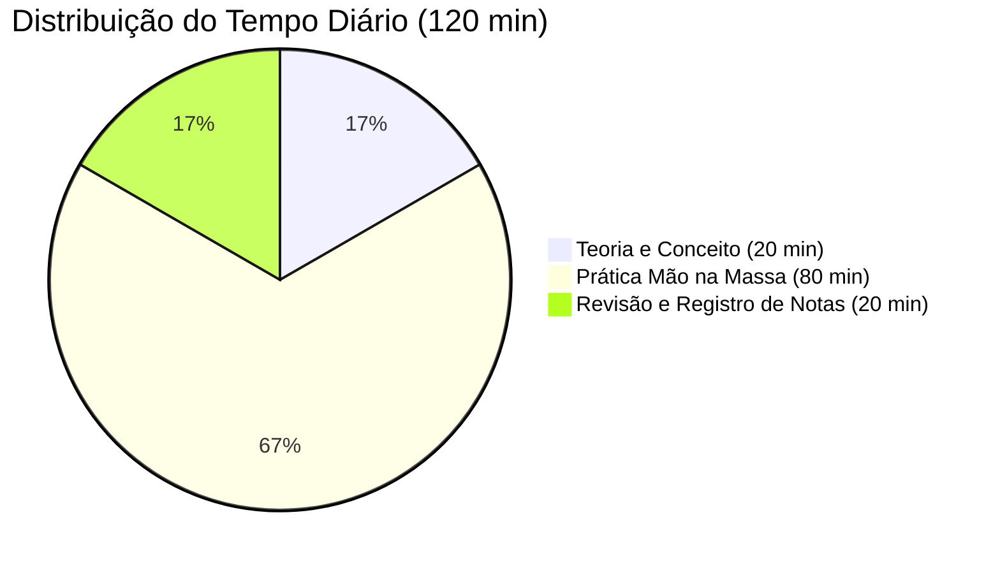

# 🧠 Potencializando Estudos com Inteligência Artificial

[](https://www.dio.me)
[](#)
[](#)

Repositório criado para documentar as atividades práticas, prompts e artefatos desenvolvidos no curso da **DIO (Digital Innovation One)** sobre como **potencializar a rotina de estudos utilizando Inteligência Artificial**.

---

## 📌 Visão Geral

O objetivo principal deste projeto é explorar as diferentes camadas de aplicação da Inteligência Artificial Generativa no processo de aprendizagem e transição de carreira:



1. [**Chatbots (IA Reativa):**](./chatbots.md) Levantamento de perfil profissional, avaliação de competências e identificação da melhor trilha de carreira tecnológica.
2. [**Copilotos (IA Contextual):**](./copiloto.md) Integração com dados do usuário (e-mails, Drive, bootcamps inscritos) para elaboração de um plano de estudos personalizado de 30 dias com divisão de tempo e metas diárias.
3. [**Agentes de IA (IA Proativa/Autônoma):**](./agentes.md) Geração e organização autônoma de artefatos, cronogramas detalhados, diretórios e repositórios de notas.

---

## 📂 Estrutura do Repositório

```bash
Potencializando Estudos com IA/
│
├── README.md               # Resumo principal do repositório
├── chatbots.md             # Prompts e respostas para diagnóstico de carreira e escolha de trilha
├── copiloto.md             # Engenharia de prompts para criação do plano de 30 dias integrado
├── agentes.md              # Registro da criação autônoma de artefatos
│
└── agentes/
    └── plano-estudos-bi/   # Estrutura modular gerada para os estudos
        ├── README.md       # Visão geral do plano de 30 dias em BI & Data Analytics
        ├── cronograma.md   # Roteiro diário detalhado (Dias 1 a 30)
        ├── recursos.md     # Links, documentações e referências por semana
        └── anotacoes/      # Templates e anotações semanais de aprendizado
            └── semana-01.md
```

---

## 🎯 Trilha de Estudos Gerada: Business Intelligence & Data Analytics

Com base na análise de histórico profissional e competências técnicas, a trilha definida foi **Business Intelligence & Data Analytics**, conectando a bagagem prévia com o **Bootcamp Universia - Primeiros Passos em Power BI (DIO)**.

### 🗓️ Resumo do Cronograma (30 Dias)

| Semana | Foco de Aprendizado | Entregável / Projeto Prático |
| :--- | :--- | :--- |
| **Semana 1** | **SQL & Power Query:** Consultas relacionais (`SELECT`, `WHERE`, `GROUP BY`, `JOINs`) e pipelines de limpeza/ETL no Power Query. | Scripts analíticos e tratamento de dados brutos |
| **Semana 2** | **Power BI & Modelagem DAX:** Star Schema, tabelas fato/dimensão, dCalendario, medidas calculadas e iteradores (`CALCULATE`, `SUMX`, *Time Intelligence*). | *Projeto DIO:* Dashboard de E-commerce com Fórmulas DAX |
| **Semana 3** | **Python para Dados:** Pandas, NumPy, Análise Exploratória (EDA), Matplotlib/Seaborn e pipelines de automação ETL integrados ao SQL. | Script Python automatizado de ETL |
| **Semana 4** | **Estatística, Storytelling & Portfólio:** Estatística descritiva, definição de KPIs de negócio, comunicação executiva e publicação de portfólio. | *Projeto DIO:* Dashboard de Vendas no Power BI + Documentação no GitHub/LinkedIn |

---

## ⏱️ Metodologia de Estudo Ativo

Para garantir consistência com **2 horas diárias de foco**, foi adotada a divisão **20/60/20**:



* **20 min (Teoria):** Leitura de documentações oficiais e vídeos conceituais curtos.
* **80 min (Prática):** Exercícios de codificação (SQL, DAX, Python) e resolução de problemas reais.
* **20 min (Revisão):** Registro de insights, erros comuns e novos comandos.

---

## 🛠️ Tecnologias e Ferramentas Exploradas

* **Ferramentas de IA:** Microsoft Copilot, ChatGPT, Google Workspace Copilot, Agentes Autônomos.
* **Dados & Análise:** SQL (Relacional), Microsoft Power BI, Power Query (Linguagem M), DAX.
* **Linguagens & Bibliotecas:** Python, Pandas, NumPy, Matplotlib, Seaborn.
* **Versionamento & Portfólio:** Git, GitHub, Markdown.

---

## 🎓 Conclusão e Próximos Passos

A utilização conjunta de **prompts estruturados**, **copilotos contextualizados** e **agentes de IA** reduz significativamente o atrito na organização dos estudos, permitindo transformar objetivos de longo prazo em rotinas práticas de alta produtividade.

---

> Desenvolvido durante os estudos do módulo de Inteligência Artificial da **[DIO](https://www.dio.me/)**.
