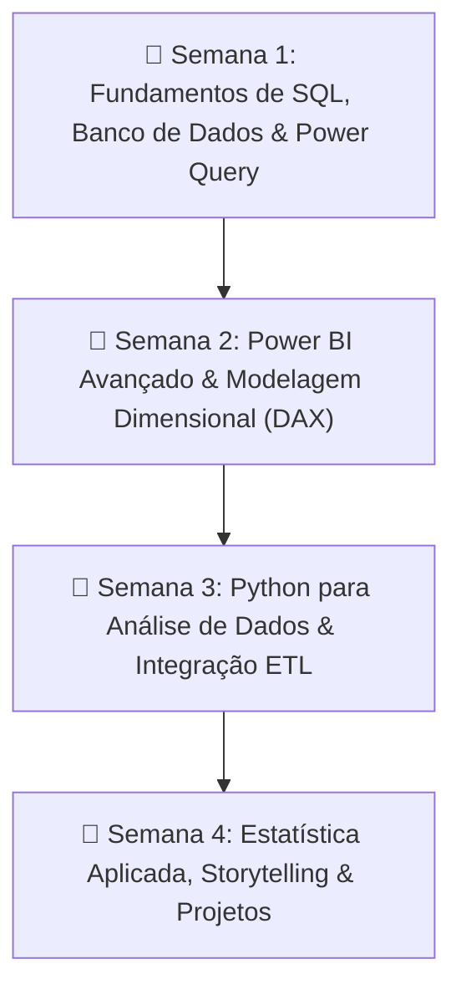

# 🚀 Plano de Estudos: 30 Dias em Business Intelligence & Data Analytics

Bem-vindo ao repositório do seu plano intensivo de 30 dias em **Business Intelligence e Data Analytics**, alinhado ao **Bootcamp Universia - Primeiros Passos em Power BI (DIO)**.

---

## 🎯 Meu Objetivo
> Desenvolver e consolidar competências práticas em **SQL**, **Power BI**, **Python para Análise de Dados**, **Engenharia de Dados (ETL)** e **Estatística/Storytelling**, construindo autonomia para criar modelos de dados eficientes, dashboards interativos e relatórios analíticos orientados a tomadas de decisão.

---

## 🧭 Visão Geral do Cronograma



| Semana | Foco Principal | Entregável / Marco Prático |
| :--- | :--- | :--- |
| **Semana 1** | Fundamentos de SQL, Relacionamentos e Power Query (ETL) | Consultas analíticas com Joins/Agregações e Pipeline de Limpeza no Power Query |
| **Semana 2** | Modelagem Star Schema, DAX Avançado e Dashboards | *Projeto DIO:* Modelando um Dashboard de E-commerce no Power BI |
| **Semana 3** | Python (Pandas, NumPy), EDA e Automação ETL | Script Python de tratamento e exportação automatizada para SQL |
| **Semana 4** | Estatística Descritiva, Storytelling e Portfólio | *Projeto Final:* Dashboard de Vendas no Power BI + Documentação no GitHub/LinkedIn |

---

## 📂 Estrutura de Arquivos

```
.
├── README.md               # Resumo geral e objetivos do plano (este arquivo)
├── cronograma.md           # Roteiro detalhado dia a dia (Dias 1 a 30)
├── recursos.md             # Links, documentações e referências por semana
└── anotacoes/              # Pasta para registros de estudo e resumos
    └── semana-01.md        # Template reutilizável para anotações semanais
```

---

## 💡 Como Usar Este Repositório
1. **Acompanhe o ritmo:** Consulte o [cronograma.md](./cronograma.md) para verificar a meta de cada dia.
2. **Faça anotações ativas:** Duplique o arquivo `anotacoes/semana-01.md` para criar `semana-02.md`, `semana-03.md` e `semana-04.md`.
3. **Consulte referências:** Use o arquivo [recursos.md](./recursos.md) para acessar materiais de apoio e documentações oficiais.
4. **Bootcamp DIO:** Garanta a submissão das atividades antes da data limite (11/10/2026).
