# 🤝 Copiloto: Planejamento Contextualizado de Estudos (30 Dias)

Este documento apresenta o plano intensivo de **30 dias em Business Intelligence & Data Analytics**, gerado via **Copiloto contextualizado**, integrando informações do perfil, histórico de materiais e a inscrição no **Bootcamp Universia - Primeiros Passos em Power BI (DIO)**.

---

## 🎯 Objetivo Central

> Desenvolver e consolidar competências práticas em **SQL**, **Power BI**, **Python para Análise de Dados**, **Engenharia de Dados (ETL)** e **Estatística/Storytelling**, construindo autonomia para criar modelos de dados eficientes, dashboards interativos e relatórios analíticos orientados a tomadas de decisão.

---

## ⏱️ Metodologia Diária: Estudo Ativo (Bloco de 2 Horas)

Utilização da proporção **20% Teoria / 60% Prática / 20% Revisão**:

| Bloco | Duração | Atividade | Foco Principal |
| :--- | :--- | :--- | :--- |
| **1. Teoria & Conceito** | 20 min | Leitura e Fundamentação | Leitura rápida de documentação oficial, artigos ou vídeos conceituais. |
| **2. Mão na Massa** | 80 min | Prática Aplicada | Exercícios práticos de SQL, manipulação no Pandas ou fórmulas DAX. |
| **3. Revisão & Notas** | 20 min | Registro e Síntese | Anotação de novos comandos, erros superados e síntese no diário de bordo. |

---

## 📅 Cronograma Semanal Detalhado

```mermaid
gantt
    title Cronograma de 30 Dias - BI & Data Analytics
    dateFormat  X
    axisFormat  Dia %d
    section Semana 1
    SQL Básico & Intermediário           :0, 3
    SQL Avançado & Joins                 :3, 5
    Power Query & ETL Inicial            :5, 7
    section Semana 2
    Modelagem Star Schema & Calendário  :7, 9
    Linguagem DAX & Contextos            :9, 12
    Dashboard E-commerce (DIO)          :12, 14
    section Semana 3
    Pandas & NumPy                       :14, 17
    EDA & Matplotlib/Seaborn             :17, 19
    Pipelines ETL com Python & SQL       :19, 21
    section Semana 4
    Estatística Descritiva & KPIs        :21, 24
    Storytelling com Dados               :24, 26
    Dashboard de Vendas & Portfólio (DIO):26, 30
```

---

### 🔹 Semana 1: Fundamentos de SQL, Banco de Dados & Power Query
* **Dia 1:** Introdução a Bancos Relacionais, SGBDs e comandos fundamentais (`SELECT`, `FROM`, `DISTINCT`, `AS`).
* **Dia 2:** Filtragem e Ordenação com `WHERE`, `ORDER BY`, `LIKE`, `IN`, `BETWEEN`.
* **Dia 3:** Funções de Agregação e Agrupamento (`COUNT`, `SUM`, `AVG`, `GROUP BY`, `HAVING`).
* **Dia 4:** Relacionando Tabelas: `INNER JOIN` e `LEFT JOIN` na prática com dados comerciais.
* **Dia 5:** Joins Avançados (`RIGHT JOIN`, `FULL OUTER JOIN`), subconsultas e conceitos de ETL.
* **Dia 6:** Power Query: Tratamento de valores nulos, tipagem e etapas aplicadas (*Applied Steps*).
* **Dia 7:** Power Query Avançado: Mesclar Consultas (Joins) e Acrescentar Consultas (Unions) + Desafio prático.

---

### 🔹 Semana 2: Power BI Avançado & Modelagem Dimensional (DAX)
* **Dia 8:** Modelagem Dimensional: Tabelas Fato vs. Dimensão, modelo *Star Schema* e criação da `dCalendario`.
* **Dia 9:** Introdução ao DAX: Diferença entre Colunas Calculadas e Medidas (`SUM`, `AVERAGE`, `COUNTROWS`).
* **Dia 10:** O Coração do DAX: Contexto de Linha vs. Filtro e a função `CALCULATE` com `ALL` e `FILTER`.
* **Dia 11:** Funções Iteradoras (*X-Functions*): `SUMX`, `AVERAGEX` e cálculos de linha a linha.
* **Dia 12:** Inteligência de Tempo (*Time Intelligence*): `SAMEPERIODLASTYEAR`, `TOTALYTD` e análise YoY.
* **Dia 13:** *Projeto Prático DIO:* Modelando um Dashboard de E-commerce com Fórmulas DAX.
* **Dia 14:** UI/UX em Dashboards: Hierarquia visual, segmentadores, tooltips e navegação.

---

### 🔹 Semana 3: Python para Análise de Dados & Integração ETL
* **Dia 15:** Python para Data Science: Estrutura de Series e DataFrames no Pandas e leitura de arquivos (`read_csv`, `read_excel`).
* **Dia 16:** Seleção e Filtragem: Manipulação via `.loc[]`, `.iloc[]`, colunas calculadas e funções `apply()`.
* **Dia 17:** Tratamento de nulos (`fillna`, `dropna`), remoção de duplicadas e agrupamentos com `.groupby()`.
* **Dia 18:** Visualização de Dados: Gráficos com Matplotlib e Seaborn (barras, linhas, histogramas e boxplots).
* **Dia 19:** Análise Exploratória de Dados (EDA) completa com matrizes de correlação e mapas de calor (`sns.heatmap`).
* **Dia 20:** Conexão Python + Banco de Dados Relacional via `sqlite3` e `SQLAlchemy`.
* **Dia 21:** Construção de Script Automatizado de ETL (funções `extract()`, `transform()`, `load()`).

---

### 🔹 Semana 4: Estatística Aplicada, Storytelling & Projetos
* **Dia 22:** Estatística Descritiva: Média, Mediana, Moda, Variância e Desvio Padrão.
* **Dia 23:** Análise de Distribuição, Correlação de Pearson e identificação de outliers.
* **Dia 24:** Definição e mapeamento de KPIs de negócio (CAC, LTV, Churn Rate, Margem de Lucro).
* **Dia 25:** Storytelling com Dados: Estruturação de narrativas claras (Contexto $\rightarrow$ Problema $\rightarrow$ Insights $\rightarrow$ Ação).
* **Dia 26:** Comunicação Executiva: Elaboração de relatórios orientados a tomada de decisões.
* **Dia 27:** *Projeto Integrador DIO (Parte 1):* Tratamento de dados e regras DAX para o Dashboard de Vendas.
* **Dia 28:** *Projeto Integrador DIO (Parte 2):* Layout final, cartões de KPIs e testes de usabilidade.
* **Dia 29:** Documentação no GitHub com prints, métricas e publicação no LinkedIn.
* **Dia 30:** Emissão da certificação DIO e autoavaliação para próximos passos.

---

## 📚 Materiais e Referências

* **Bootcamp DIO:** *Universia - Primeiros Passos em Power BI*.
* **SQL:** *SQLBolt*, *W3Schools SQL Tutorial*, *Mode Analytics*.
* **Power BI & DAX:** *Microsoft Learn*, portal *SQLBI (Marco Russo & Alberto Ferrari)*.
* **Python:** Documentação oficial do *Pandas* e livro *Python for Data Analysis (Wes McKinney)*.
* **Storytelling:** Livro *Storytelling com Dados (Cole Nussbaumer Knaflic)*.
